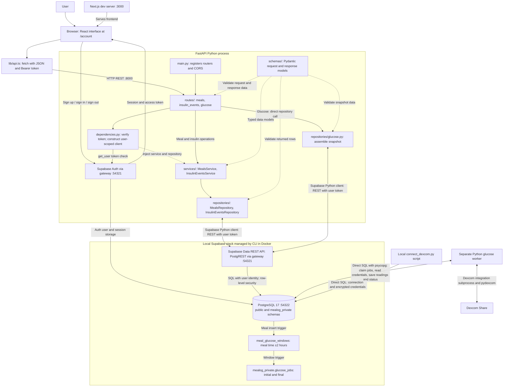
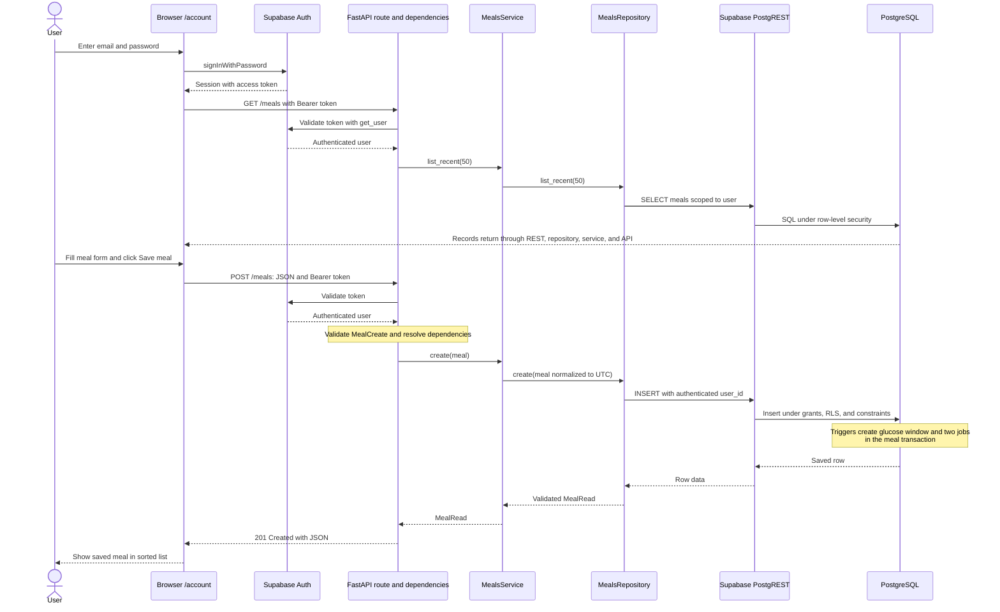

# Mealog architecture and request flows

This describes the current working-tree implementation, including uncommitted changes, inspected on 9 November 2026. It describes code and local configuration, rather than a verified running deployment.

## Architecture

Solid arrows show calls, data transfer, or trigger effects; dotted arrows show code dependencies. Ordinary API responses return through the same layers in reverse. The database window and job nodes represent records within PostgreSQL, not additional services.

The documented local setup starts Docker-backed Supabase, FastAPI, and Next.js separately. There is no project Docker Compose file or Dockerfile in this checkout. The glucose worker is another separately started process; importing the FastAPI application does not launch it. Supabase Studio at port 54323 is an administrative interface.

## Backend responsibilities

| Component | Responsibility | Example |
| --- | --- | --- |
| `main.py` | Assemble the application, register routes, permit local frontend origins, expose health checks | Register the `/meals` router |
| `routes/` | Map HTTP methods and paths to operations; declare request/response models; translate failures into HTTP responses | `POST /meals` calls `MealsService.create` and returns 201 |
| `dependencies.py` | Validate the bearer token through Supabase Auth; obtain the authenticated user; attach the token to PostgREST; build services and repositories | Inject `MealsService(MealsRepository(client, user_id))` |
| `schemas/` | Validate and describe Python/API data with Pydantic | Nonempty meal name, nonnegative carbohydrates, timezone-aware timestamps, positive insulin dose |
| `services/` | Apply application rules before persistence | Normalize eating/injection times to UTC; check ownership of a linked meal |
| `repositories/` | Query and change stored records; filter by authenticated owner; validate returned rows | Insert a meal with server-derived `user_id` |
| `supabase/migrations/` | Define SQL tables, relationships, constraints, grants, row-level security, and triggers | Create a glucose window and queue jobs when a meal is inserted |

The glucose route currently calls `GlucoseRepository` directly: there is no glucose service layer. It combines several queries into a `GlucoseSnapshot` containing window status, readings, meals, injections, activities, and notes.

Python schemas and PostgreSQL schemas are different concepts. Pydantic models describe the shape and validity of data passing through code. PostgreSQL schemas such as `public`, `auth`, and `mealog_private` are namespaces containing persistent database objects. Python schema files do not create SQL tables; migrations do.

## REST API map

All meal, insulin, and glucose routes require `Authorization: Bearer <access_token>`. The two health routes do not.

| Method | Path | Operation |
| --- | --- | --- |
| GET | `/health` | Check the FastAPI process |
| GET | `/health/database` | Read the synthetic `connection_checks` record through Supabase |
| GET | `/meals?limit=50` | List the current user's meals, most recent eating time first |
| POST | `/meals` | Create a meal; return 201 and its saved representation |
| PATCH | `/meals/{meal_id}/context` | Change supplied activity, consumption, and note fields |
| GET | `/meals/{meal_id}/glucose` | Read a stored glucose snapshot and timeline markers |
| GET | `/insulin-events?limit=50&meal_id=...` | List insulin events, optionally filtered to an owned meal |
| POST | `/insulin-events` | Create an insulin event; return 201 |
| PUT | `/insulin-events/{event_id}` | Replace editable insulin fields |

Both list endpoints default to 50 records and accept limits from 1 to 100. No delete endpoints are implemented.

## User journey: signing in and saving a meal

1. The functional account interface is `/account`; `/` is still the Next.js starter page. The browser subscribes to Supabase authentication changes and shows either the login/registration form or private meal controls.
2. Login and registration use the Supabase JavaScript client directly. Once authenticated, React uses the session's access token to load meals through FastAPI. The insulin panel also loads recent insulin events.
3. On saving a meal, the browser turns the device-local eating time into an ISO timestamp and sends JSON through `lib/api.ts`. That helper adds the bearer token, sets the JSON content type for requests with a body, applies a 15-second default timeout, and converts failed responses into errors for the interface.
4. FastAPI validates the request using `MealCreate`. Its authentication dependency asks Supabase Auth to validate the token, obtains the user ID, and configures a Supabase client carrying that token. Its service dependency constructs the user-scoped repository and meal service. Validation and dependency resolution both happen before the route's business operation.
5. The service normalizes the eating timestamp to UTC. The repository serializes the model, adds the authenticated user ID, and inserts it using the Supabase Python client. This is another HTTP REST call to PostgREST, which issues SQL to PostgreSQL.
6. PostgreSQL checks permissions, ownership policies, and constraints. Its triggers create the glucose window and collection jobs in the same transaction. A failure in that transaction prevents the meal insert from committing.
7. The repository validates the returned row as `MealRead`; FastAPI serializes the response. React inserts the saved meal into its local list, sorts it by eating time, and displays confirmation without reloading the page.

There are two ownership checks: repositories scope queries by `user_id`, and PostgreSQL row-level security restricts accessible rows using the forwarded user's identity. The API derives ownership from authentication rather than accepting a caller-supplied owner ID.

## Editing context and logging insulin

The context form compares edited values with the original meal and sends only changed fields using PATCH. Activity and its timestamp must be set or cleared together; the same applies to notes and their timestamp. The database updates `context_updated_at` when context values actually change.

Insulin creation and editing use POST and PUT respectively. The insulin service checks that an optional linked meal belongs to the authenticated user and normalizes the injection time to UTC. Database ownership policies and a composite foreign key reinforce the linked-meal relationship. An update preserves ownership and creation time; a database trigger records actual changes in `updated_at`.

Successful context or insulin edits increment the account page's timeline version, remounting chart components. The user then loads the updated timeline using its button.

## Background glucose collection and timeline display

1. A database trigger creates a window from two hours before eating to two hours afterward. A second trigger queues an initial job immediately and a final job for the window end plus ten minutes, or immediately if that time has passed.
2. A separately running Python worker claims due jobs with transactional row locks and `SKIP LOCKED`. It uses `psycopg` and `DATABASE_URL` to connect directly to PostgreSQL, including the private job and credential tables.
3. It checks for an enabled Dexcom connection, decrypts its credentials using the configured Fernet key, and calls the Dexcom integration in a subprocess. That integration retrieves up to 24 hours of recent readings with `pydexcom` and validates the result as `SourceBatch`.
4. The worker stores readings within the meal window, deduplicates by connection and measurement time, flags conflicting values, and updates coverage status. Coverage remains pending until the window end plus ten minutes; afterward, boundary coverage and gaps determine `ready` or `partial`. Retrieval failures are retried up to three attempts. Missing credentials produce `awaiting_connection`.
5. Clicking **Load meal timeline** or **Refresh timeline** calls `GET /meals/{meal_id}/glucose`. This reads stored data; it does not contact Dexcom or launch the worker. The repository combines readings with all of the user's meal, injection, activity, and note markers occurring inside the window, not just events explicitly linked to the selected meal.
6. React renders the snapshot using Recharts, with time relative to eating time. Conflicting readings and gaps over ten minutes appear as breaks. There is no automatic chart polling or Supabase Realtime subscription in the current frontend.

Dexcom setup currently uses `services/api/scripts/connect_dexcom.py`, not a website REST endpoint. It authenticates the Mealog user, verifies the Dexcom account, and stores connection metadata plus encrypted credentials. The private schema is excluded from normal anonymous and authenticated API access.

## Errors and diagnostics

- Invalid request bodies, IDs, or query parameters normally produce FastAPI validation responses (422).
- Missing or invalid bearer tokens produce 401; temporary authentication outages produce 503.
- Missing owned records or linked meals produce 404 in the relevant routes.
- Operational failures are logged on the backend and generally returned as 503 with a short message.
- `/connection-check` calls `/health` and `/health/database` to test backend reachability and a synthetic database read. It does not verify private-data authorization or Dexcom collection.

## Source map

- Frontend account/session and meal flow: `apps/web/src/app/account/page.tsx`
- Frontend REST helper: `apps/web/src/lib/api.ts`
- Browser authentication client: `apps/web/src/lib/supabase-browser.ts`
- User controls: `apps/web/src/components/{meals,insulin,glucose}/`
- FastAPI assembly and authentication: `services/api/src/mealog_api/{main,dependencies}.py`
- Backend layers: `services/api/src/mealog_api/{routes,schemas,services,repositories}/`
- Collector: `services/api/src/mealog_api/jobs/glucose_worker.py`
- Dexcom integration/setup: `services/api/src/mealog_api/integrations/` and `services/api/scripts/connect_dexcom.py`
- Database definitions and local ports: `supabase/migrations/` and `supabase/config.toml`
