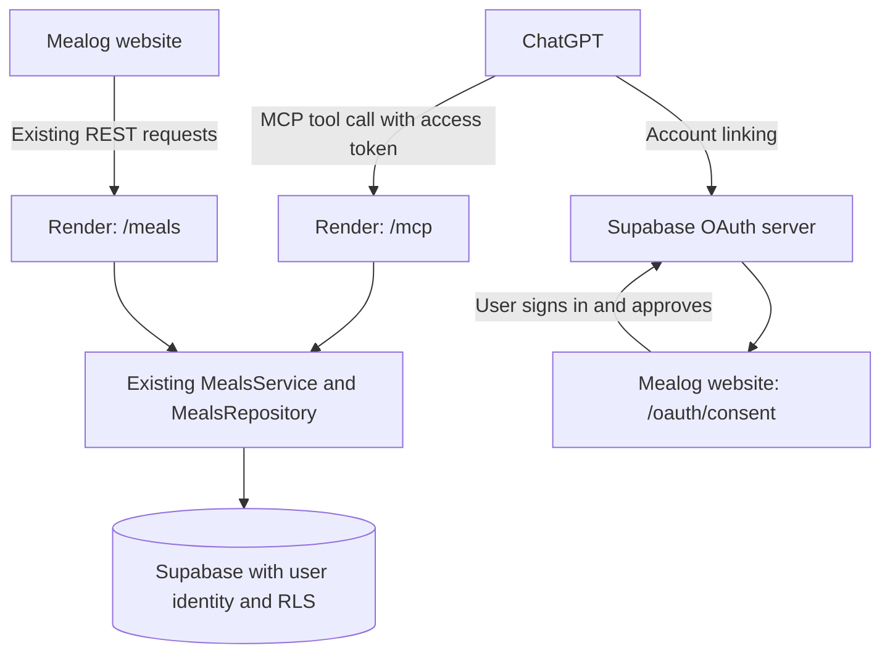

# Mealog: a working `log_meal` MCP prototype

Prepared for this repository on 18 November 2026.

This is an implementation guide with complete file contents. It does **not** mean the prototype has already been deployed. The application files below have not been added to your running application. Follow the steps to implement them, then run the live checks at the end.

The design uses your existing Render API service, your existing Supabase project, and your existing Next.js website. The only MCP tool is `log_meal`.

## 1. What you will build

After setup, a user can connect their Mealog account in ChatGPT and say:

> Use Mealog to log chicken rice on November 18, 2026 at 12:30pm Singapore time, with 65 grams of carbohydrates.

ChatGPT constructs the arguments, calls your MCP server, and gets the saved meal back. The same meal appears in Mealog after refreshing its meal list.



The OAuth server is the component that gives ChatGPT permission to act as a user. Supabase runs it. Your MCP server verifies the resulting token. The consent page is a normal page on your existing website; it is not a ChatGPT widget.

Supabase documents this arrangement in its [MCP authentication guide](https://supabase.com/docs/guides/auth/oauth-server/mcp-authentication). MCP tools can operate without custom ChatGPT UI; see the [OpenAI server guide](https://developers.openai.com/plugins/build/mcp-server).

For this first prototype, use a dedicated Mealog test account and synthetic meal descriptions. The integration exposes only `log_meal`, but the underlying Supabase token retains the database access already allowed by your RLS policies. This guide does not claim to make that token insert-only. Identity scopes such as `openid` do not impose database permissions; [Supabase explains that distinction here](https://supabase.com/docs/guides/auth/oauth-server/token-security).

## 2. File structure

Run shell commands from the repository root unless a step says otherwise. The root on this computer is `/Users/yumin/Documents/GitHub/Mealog`.

```text
Mealog/
├── services/api/
│   ├── pyproject.toml                   # add two dependencies
│   ├── uv.lock                          # updated by uv add
│   ├── .env                             # local MCP settings; do not commit
│   ├── src/mealog_api/
│   │   ├── main.py                      # connect MCP startup and routes
│   │   └── mcp/                         # NEW Python package
│   │       ├── __init__.py
│   │       ├── settings.py              # MCP environment settings
│   │       ├── auth.py                  # verify Supabase OAuth tokens
│   │       ├── server.py                # define and implement log_meal
│   │       └── integration.py           # mount MCP inside FastAPI
│   └── tests/unit/test_mcp_log_meal.py   # NEW tests
└── apps/web/src/app/oauth/consent/       # NEW website route
    ├── page.tsx
    └── consent-form.tsx
```

You do not need another top-level backend service. Keep the new package under `mealog_api/mcp/`; do not create a top-level Python package named `mcp`, because that would shadow the installed MCP SDK.

Your existing meal schemas, service, repository, and authentication dependency are reused. Meal inserts also retain existing database-trigger behavior, including glucose-window/job creation.

## 3. Prerequisites and dependency versions

You need a working existing deployment of the Mealog API and website, both using the same hosted Supabase project. You also need ChatGPT access that permits adding custom MCP integrations; workspace restrictions can affect this.

The code below targets the official Python **`mcp==2.3.0`** SDK. Version 2 uses `MCPServer`; older tutorials commonly use the version 1 `FastMCP` interface. Do not combine their import paths and constructor settings. The [SDK migration guide](https://github.com/modelcontextprotocol/python-sdk/blob/main/docs/migration.md) explains the changes.

Install from the API directory:

```bash
cd services/api
uv add 'mcp==2.3.0' 'PyJWT[crypto]>=2.10,<3'
```

`uv add` changes `pyproject.toml` and `uv.lock`. Commit both when you implement this. PyJWT checks signed access tokens; its crypto extra supports Supabase's asymmetric signing keys. No additional OpenAI API key or model call is needed for this text-logging tool.

Create the directories from the repository root:

```bash
mkdir -p services/api/src/mealog_api/mcp
mkdir -p apps/web/src/app/oauth/consent
```

## 4. Configure Supabase account linking

There are three different URLs. Keep their roles separate:

| Name | Example | Purpose |
| --- | --- | --- |
| API/MCP endpoint | `https://mealog-q4bz.onrender.com/mcp` | Receives MCP calls |
| Website consent page | `https://mealog-eight.vercel.app/oauth/consent` | Lets a user sign in and approve |
| Authorization server issuer | `https://hkcaridgtdvjcclpdocz.supabase.co/auth/v1` | Issues the access tokens |

Replace the capitalized examples with your real deployment values throughout this guide. Do not use the Supabase *management MCP connector*: that connector is for managing Supabase projects, not for exposing Mealog's meal tools.

### 4.1 Enable Supabase's OAuth server

In the hosted Supabase dashboard:

1. Open **Authentication → OAuth Server** and enable its OAuth server.
2. Set the authorization path to `/oauth/consent`.
3. Check **Authentication → URL Configuration → Site URL**. It must be the origin of your deployed Mealog website, which will serve that consent page.
4. Leave dynamic client registration off for this prototype. We will explicitly register ChatGPT as one OAuth client.
5. Check **JWT Signing Keys**. This implementation requires an active asymmetric signing key, ES256 or RS256, published through the project's JWKS endpoint. It intentionally does not accept legacy HS256 tokens. If your project still uses a legacy signing secret, follow Supabase's documented key-migration process first; do not discard a signing key that existing sessions still need.

These are hosted dashboard settings; changing local `supabase/config.toml` alone does not configure the hosted project. See [Supabase OAuth setup](https://supabase.com/docs/guides/auth/oauth-server/getting-started) and [JWT signing keys](https://supabase.com/docs/guides/auth/signing-keys).

### 4.2 Register the ChatGPT OAuth client

**Order of work:** You can inspect ChatGPT's setup form now, but finishing the connection requires the MCP endpoint and OAuth discovery routes from steps 5–9 to be deployed. At this stage, prepare the OAuth client and save its credentials; return to ChatGPT to complete linking after deployment.

To open the current documented setup form, use ChatGPT in a web browser and visit [ChatGPT Plugins](https://chatgpt.com/plugins). Select the plus button, then **Add custom MCP server**. For this project, enter `Mealog prototype` as the name, `https://mealog-q4bz.onrender.com/mcp` as the Server URL under Connection, and choose **OAuth**. This connects a running server; it does not upload or create the Python tool code. Account and workspace permissions can affect whether the creation option appears. See [OpenAI's connection instructions](https://developers.openai.com/plugins/deploy/connect-chatgpt).

You need an OAuth **client ID** and **client secret**. These identify the ChatGPT integration, not an individual user. They are different from your Supabase publishable key and service-role key.

In Supabase, client registration is on **Authentication → OAuth Apps**, under the **Manage** section, rather than the OAuth Server configuration page. Select **Add a new client**, enter the client name and redirect URI, choose **Confidential**, and select **Create**. Supabase returns the Client ID and Client Secret; the secret is shown only once. The OAuth Server page's authorization/token/JWKS endpoint URLs are not client IDs. See [Register an OAuth client](https://supabase.com/docs/guides/auth/oauth-server/getting-started#register-an-oauth-client).

Begin adding a custom MCP integration in ChatGPT to obtain its exact OAuth redirect/callback URI. Copy the URI shown by the integration setup or management screen. Register a **confidential** OAuth client in Supabase named `Mealog ChatGPT prototype`, with that exact URI and `client_secret_basic` token endpoint authentication. Save the client ID and secret securely.

The callback belongs to ChatGPT. It is **not** your `/oauth/consent` URL. OpenAI currently documents both a stable callback and callback-specific URIs, depending on issuer metadata. Use the URI actually shown for your connection; [OpenAI's authentication guide](https://developers.openai.com/plugins/build/auth) explains these variants.

If the ChatGPT interface requires client credentials before it shows a connection-specific callback, register the client initially with the stable URI documented by OpenAI, `https://chatgpt.com/connector_platform_oauth_redirect`. Enter its credentials in the ChatGPT setup, then inspect the resulting connection's exact redirect URI and update the Supabase client's allowlist **before completing or retrying sign-in**. A callback-specific URI must replace that initial value when the connection requires it. A failed first authorization at this stage does not require changing your MCP tool code.

Never put the OAuth client secret in browser code, a chat message, or a committed file. ChatGPT's OAuth configuration holds it. The MCP backend needs only the client ID allowlist.

## 5. Add the backend files

### 5.1 Settings

MCP is disabled by default. Enabling it without a registered client ID fails at startup, so an incomplete configuration cannot accidentally expose a working meal tool.

**File: `services/api/src/mealog_api/mcp/__init__.py`**

```python
"""ChatGPT-facing MCP adapter for Mealog."""
```

**File: `services/api/src/mealog_api/mcp/settings.py`**

```python
from pydantic import AnyHttpUrl, model_validator
from pydantic_settings import BaseSettings, SettingsConfigDict

from mealog_api.config import ENV_FILE


class MCPSettings(BaseSettings):
    model_config = SettingsConfigDict(
        env_file=ENV_FILE, env_prefix="mealog_mcp_", extra="ignore"
    )

    enabled: bool = False
    public_url: AnyHttpUrl = "http://127.0.0.1:8000/mcp"
    allowed_client_ids: list[str] = []

    @model_validator(mode="after")
    def require_client(self):
        if self.enabled and not self.allowed_client_ids:
            raise ValueError("Set MEALOG_MCP_ALLOWED_CLIENT_IDS before enabling MCP.")
        if self.public_url.path != "/mcp" or self.public_url.query or self.public_url.fragment:
            raise ValueError("MCP public URL must end in /mcp with no query or fragment.")
        return self
```

### 5.2 Token verification

A JWT is a signed token containing facts such as user ID, expiry, issuer, audience, and OAuth client ID. This verifier checks the signature against Supabase's public keys and checks those facts before accepting it.

The audience is Supabase's default identifier, `authenticated`. Because that identifier is shared, the verifier **also requires the dedicated OAuth client ID**. A normal website session token without that ID cannot call MCP. This provider-specific check is why `validate_token_resource=False` appears later: the token is not claimed to have your `/mcp` URL as its audience. A future integration supporting multiple resource audiences should use dedicated audience claims and verify them explicitly. See the [SDK authorization guide](https://github.com/modelcontextprotocol/python-sdk/blob/main/docs/run/authorization.md).

**File: `services/api/src/mealog_api/mcp/auth.py`**

```python
import logging
from uuid import UUID

import jwt
from jwt import PyJWKClient
from mcp.server.auth.provider import AccessToken
from starlette.concurrency import run_in_threadpool

logger = logging.getLogger(__name__)


class SupabaseTokenVerifier:
    def __init__(self, supabase_url: str, allowed_client_ids: list[str]):
        self.issuer = supabase_url.rstrip("/") + "/auth/v1"
        self.allowed_client_ids = set(allowed_client_ids)
        self.keys = PyJWKClient(self.issuer + "/.well-known/jwks.json", timeout=10)

    def _verify(self, token: str) -> AccessToken | None:
        try:
            key = self.keys.get_signing_key_from_jwt(token).key
            claims = jwt.decode(
                token,
                key,
                algorithms=["ES256", "RS256"],
                issuer=self.issuer,
                audience="authenticated",
                options={"require": ["exp", "iat", "iss", "aud", "sub", "client_id"]},
            )
            client_id = claims["client_id"]
            if client_id not in self.allowed_client_ids:
                return None
            if claims.get("role") != "authenticated" or claims.get("is_anonymous") is True:
                return None
            subject = str(UUID(claims["sub"]))
            # The audience AND registered OAuth client identify this integration.
            # Do not label a generic Supabase JWT as bound to an MCP resource URL.
            return AccessToken(
                token=token,
                client_id=client_id,
                scopes=[],
                expires_at=int(claims["exp"]),
                subject=subject,
                claims={"iss": self.issuer},
            )
        except (jwt.PyJWTError, ValueError, TypeError, KeyError):
            return None
        except Exception as error:
            # Never log raw tokens, credentials, or decoded user information.
            logger.warning("MCP token verification unavailable: %s", type(error).__name__)
            return None

    async def verify_token(self, token: str) -> AccessToken | None:
        # JWKS retrieval can do network I/O; keep it off the async event loop.
        return await run_in_threadpool(self._verify, token)
```

### 5.3 The tool definition and implementation

The decorated `log_meal` function is the tool. Its typed parameters generate the input schema. Its Pydantic return model generates structured output. The description helps ChatGPT decide when and how to call it; validation and authentication enforce the actual rules.

The tool receives an access token through MCP's authenticated request context. It passes that token to your existing authentication dependency, which verifies the user with Supabase and constructs a user-scoped database client. This also preserves your existing RLS behavior. No `user_id` argument is exposed to the model.

The synchronous database work runs in a thread so it does not block FastAPI's async event loop. Successful output contains the saved record's ID; operational failures are returned as tool errors, not fabricated success messages.

**File: `services/api/src/mealog_api/mcp/server.py`**

```python
import logging
from typing import Annotated, Literal
from uuid import UUID

from fastapi import HTTPException
from fastapi.security import HTTPAuthorizationCredentials
from mcp.server import MCPServer
from mcp.server.auth.middleware.auth_context import get_access_token
from mcp.server.auth.settings import AuthSettings
from mcp.server.mcpserver.exceptions import ToolError
from mcp_types import ToolAnnotations
from pydantic import AwareDatetime, BaseModel, Field
from starlette.concurrency import run_in_threadpool

from mealog_api.config import settings
from mealog_api.dependencies import get_authenticated_database, get_meals_service
from mealog_api.mcp.auth import SupabaseTokenVerifier
from mealog_api.mcp.settings import MCPSettings
from mealog_api.repositories.creation_requests import CreationRequestConflict
from mealog_api.schemas.meals import MealCreate

logger = logging.getLogger(__name__)


class SavedMeal(BaseModel):
    id: UUID
    name: str
    eaten_at: AwareDatetime
    carbohydrates_g: float | None
    fraction_consumed: float | None
    notes: str | None


class LogMealResult(BaseModel):
    status: Literal["saved"] = "saved"
    meal: SavedMeal


def save_meal(token: str, meal: MealCreate, request_id: UUID) -> LogMealResult:
    database = get_authenticated_database(
        HTTPAuthorizationCredentials(scheme="Bearer", credentials=token)
    )
    service = get_meals_service(database)
    saved = service.create(meal, request_id)
    return LogMealResult(meal=SavedMeal.model_validate(saved.model_dump()))


def build_mcp(config: MCPSettings) -> MCPServer:
    issuer = settings.supabase_url.rstrip("/") + "/auth/v1"
    server = MCPServer(
        "Mealog",
        version="0.1.0",
        instructions=(
            "Log meals only when the user asks. Ask for missing eating time or timezone. "
            "Do not invent carbohydrate values. Generate a UUID request_id once per new "
            "meal submission; reuse it AND the identical meal arguments for retries. "
            "Only report a saved meal after log_meal succeeds."
        ),
        token_verifier=SupabaseTokenVerifier(
            settings.supabase_url, config.allowed_client_ids
        ),
        auth=AuthSettings(
            issuer_url=issuer,
            resource_server_url=str(config.public_url),
            required_scopes=[],
            # Supabase uses its own audience identifier. Our verifier checks
            # that audience plus the specific registered OAuth client ID.
            validate_token_resource=False,
        ),
    )

    @server.tool(
        name="log_meal",
        description=(
            "Save one meal to the signed-in user's Mealog account. Use only when "
            "the user asks to log a meal. Ask for missing time/timezone; send an "
            "ISO 8601 timestamp with offset. Leave unknown carbs null. Generate "
            "a UUID request_id for each new submission and reuse the same UUID "
            "and identical arguments on retries. This tool cannot edit a meal."
        ),
        annotations=ToolAnnotations(
            readOnlyHint=False,
            destructiveHint=False,
            idempotentHint=True,
            openWorldHint=False,
        ),
        meta={"securitySchemes": [{"type": "oauth2", "scopes": []}]},
    )
    async def log_meal(
        name: Annotated[str, Field(min_length=1, max_length=200)],
        eaten_at: Annotated[AwareDatetime, Field(description="Eating time, including UTC offset.")],
        request_id: Annotated[UUID, Field(description="Stable UUID for this submission and retries.")],
        carbohydrates_g: Annotated[float | None, Field(ge=0, le=999999.99, allow_inf_nan=False)] = None,
        fraction_consumed: Annotated[float | None, Field(ge=0, le=1, allow_inf_nan=False)] = None,
        notes: Annotated[str | None, Field(max_length=2000)] = None,
    ) -> LogMealResult:
        access = get_access_token()
        if access is None:
            raise ToolError("Connect your Mealog account before logging a meal.")
        meal = MealCreate(
            name=name,
            eaten_at=eaten_at,
            carbohydrates_g=carbohydrates_g,
            fraction_consumed=fraction_consumed,
            notes=notes,
        )
        try:
            return await run_in_threadpool(save_meal, access.token, meal, request_id)
        except CreationRequestConflict:
            raise ToolError(
                "That request_id was used with different meal details. Do not "
                "automatically create a new ID; confirm whether this is another meal."
            ) from None
        except HTTPException as error:
            if error.status_code == 401:
                raise ToolError("Your Mealog login expired. Reconnect your account.") from None
            raise ToolError("Mealog authentication is temporarily unavailable. Retry later.") from None
        except Exception as error:
            logger.warning("MCP meal save failed: %s", type(error).__name__)
            raise ToolError(
                "The save could not be confirmed. Retry with the SAME request_id "
                "and identical arguments to avoid a duplicate."
            ) from None

    return server
```

`request_id` is required because a network timeout can happen after the database has already committed. Your existing `MealsService.create(..., request_id)` and creation-request repository handle repeated submissions. Repeating the same UUID and identical arguments returns the existing meal; changing the payload with that UUID produces a conflict.

This prevents duplicate storage for an identical keyed retry. It does not guarantee that a language model will always reuse the same key. A new UUID can create another row. The prompt instructions and tests make the intended behavior clear; a later product can issue server-managed draft IDs if stronger control is needed.

### 5.4 Share the existing FastAPI process

The SDK creates an ASGI application, which is a Python web application that Uvicorn/FastAPI can serve. Its session manager must be started and stopped by the parent application's lifespan. Stateless transport avoids keeping conversational MCP sessions in this one API process; authentication and database persistence still apply.

Mounting the SDK app at `/` is intentional. Inside that app, the tool transport is already `/mcp`, and OAuth discovery is `/.well-known/oauth-protected-resource/mcp`. Mounting it at `/mcp` without adjusting those paths would produce the wrong URLs. The root mount must be added **after** existing API routes. See [SDK ASGI integration](https://github.com/modelcontextprotocol/python-sdk/blob/main/docs/run/asgi.md).

**File: `services/api/src/mealog_api/mcp/integration.py`**

```python
from contextlib import asynccontextmanager
from urllib.parse import urlsplit

from fastapi import FastAPI
from mcp.server.transport_security import TransportSecuritySettings

from mealog_api.mcp.server import build_mcp
from mealog_api.mcp.settings import MCPSettings

config = MCPSettings()
server = build_mcp(config) if config.enabled else None

if server is not None:
    url = urlsplit(str(config.public_url))
    http_app = server.streamable_http_app(
        streamable_http_path="/mcp",
        stateless_http=True,
        json_response=True,
        transport_security=TransportSecuritySettings(
            enable_dns_rebinding_protection=True,
            allowed_hosts=[url.netloc],
            allowed_origins=[f"{url.scheme}://{url.netloc}", "https://chatgpt.com"],
        ),
    )
else:
    http_app = None


@asynccontextmanager
async def lifespan(app: FastAPI):
    if server is None:
        yield
    else:
        async with server.session_manager.run():
            yield


def mount_mcp(app: FastAPI) -> None:
    if http_app is not None:
        # Add LAST: specific REST/health/docs routes must take precedence.
        # Mount at / because the SDK app already owns its /mcp route AND
        # /.well-known/oauth-protected-resource/mcp discovery route.
        app.mount("/", http_app)
```

### 5.5 Make three changes to `main.py`

Keep the existing router imports, middleware, and health-check handlers. Add this import:

```python
from mealog_api.mcp.integration import lifespan as mcp_lifespan, mount_mcp
```

Replace the existing FastAPI constructor:

```python
app = FastAPI(title="Mealog API", lifespan=mcp_lifespan)
```

At the **very end of the file**, after both health handlers and all router registration, add:

```python
mount_mcp(app)
```

The current `main.py` has no custom lifespan, so this replacement fits the inspected code. If you add another lifespan later, combine their context managers instead of overwriting one.

### 5.6 Environment settings

For your hosted implementation, set these on the **existing Mealog API service in Render**. You do not need a local `.env` file for Render to read dashboard environment variables.

Open Render → Mealog API service → **Environment** → **Add Environment Variable**, and enter these key/value pairs:

| Key | Value |
| --- | --- |
| `MEALOG_MCP_ENABLED` | `true` |
| `MEALOG_MCP_PUBLIC_URL` | `https://mealog-q4bz.onrender.com/mcp` |
| `MEALOG_MCP_ALLOWED_CLIENT_IDS` | `["YOUR-SUPABASE-OAUTH-CLIENT-ID"]` |

`YOUR-SUPABASE-OAUTH-CLIENT-ID` is a placeholder for the **Client ID of the OAuth application you registered under Supabase → Authentication → OAuth Apps in step 4.2**, named `Mealog ChatGPT prototype`. Copy that application's generated ID. It is not the Supabase project reference, user ID, API/publishable key, or client secret. The same application client ID is used for all Mealog users who connect through this ChatGPT integration; each user gets their own access token and user identity.

For an example ID `12345678-1234-4234-8234-123456789abc`, paste exactly `["12345678-1234-4234-8234-123456789abc"]` into the Render value field. Keep the square brackets and double quotes; do not add single quotes around the whole value. The backend uses this allowlist to accept OAuth tokens for the configured integration.

Keep the existing hosted `SUPABASE_URL` and `SUPABASE_PUBLISHABLE_KEY`. Choose **Save, rebuild, and deploy** when deploying the new code/dependencies, or **Save and deploy** if the correct build is already deployed. **Save only** will not apply the new values to the running service until its next deployment. See [Render's environment-variable instructions](https://render.com/docs/configure-environment-variables).

The three MCP values enable and configure the code from this guide; setting them does not itself add `/mcp` to an older build. Deploy the MCP code as well.

For completeness, optional local development would instead put these in **`services/api/.env`**:

```dotenv
MEALOG_MCP_ENABLED=true
MEALOG_MCP_PUBLIC_URL=http://127.0.0.1:8000/mcp
MEALOG_MCP_ALLOWED_CLIENT_IDS=["YOUR-SUPABASE-OAUTH-CLIENT-ID"]
```

Skip that local configuration if you are only deploying the hosted implementation. Use your hosted Supabase project and hosted website together.

## 6. Add the website consent page

Set this additional environment variable in your website host and, if testing the page locally, in `apps/web/.env.local`:

```dotenv
NEXT_PUBLIC_MEALOG_MCP_CLIENT_ID=YOUR-SUPABASE-OAUTH-CLIENT-ID
```

This ID is public metadata, so it can be included in the browser bundle. The **secret** must not be a `NEXT_PUBLIC_` variable. Rebuild/redeploy the website after setting it because Next.js public environment values are embedded at build time.

Your current login page always sends signed-in users to `/home`. Rather than changing that existing flow, this consent page includes a small password sign-in form and keeps the OAuth `authorization_id` in the current URL. It assumes an existing email/password Mealog account. It does not implement signup or MFA; if your test account requires MFA, complete sign-in on the normal site first and then restart linking in the same browser.

Supabase, rather than this page, validates redirect URIs, manages authorization codes, and exchanges them for tokens. The page only displays the request and submits the user's decision. The APIs are documented in [Supabase's OAuth flow guide](https://supabase.com/docs/guides/auth/oauth-server/oauth-flows).

**File: `apps/web/src/app/oauth/consent/page.tsx`**

```tsx
import ConsentForm from "./consent-form";

export default async function ConsentPage({
  searchParams,
}: {
  searchParams: Promise<{ authorization_id?: string | string[] }>;
}) {
  const query = await searchParams;
  const id = typeof query.authorization_id === "string" ? query.authorization_id : "";
  return <ConsentForm authorizationId={id} />;
}
```

**File: `apps/web/src/app/oauth/consent/consent-form.tsx`**

```tsx
"use client";

import { useEffect, useState, type FormEvent } from "react";
import type { OAuthAuthorizationDetails } from "@supabase/supabase-js";
import { getSupabaseBrowser } from "@/lib/supabase-browser";

export default function ConsentForm({ authorizationId }: { authorizationId: string }) {
  const [details, setDetails] = useState<OAuthAuthorizationDetails | null>(null);
  const [needsLogin, setNeedsLogin] = useState(false);
  const [email, setEmail] = useState("");
  const [password, setPassword] = useState("");
  const [error, setError] = useState("");
  const [busy, setBusy] = useState(false);
  const [reload, setReload] = useState(0);

  useEffect(() => {
    let active = true;
    async function load() {
      try {
        if (!authorizationId) throw new Error("Start account linking from ChatGPT.");
        const supabase = getSupabaseBrowser();
        const { data: session, error: sessionError } = await supabase.auth.getSession();
        if (sessionError) throw sessionError;
        if (!active) return;
        if (!session.session) {
          setNeedsLogin(true);
          return;
        }
        setNeedsLogin(false);
        const { data, error: detailsError } =
          await supabase.auth.oauth.getAuthorizationDetails(authorizationId);
        if (detailsError) throw detailsError;
        if (!active) return;
        if ("redirect_url" in data) {
          window.location.assign(data.redirect_url);
          return;
        }
        const expected = process.env.NEXT_PUBLIC_MEALOG_MCP_CLIENT_ID;
        if (!expected || data.client.id !== expected) {
          throw new Error("This OAuth client is not enabled for the Mealog prototype.");
        }
        setDetails(data);
      } catch (cause) {
        if (active) setError(cause instanceof Error ? cause.message : "Could not load consent.");
      }
    }
    void load();
    return () => { active = false; };
  }, [authorizationId, reload]);

  async function signIn(event: FormEvent<HTMLFormElement>) {
    event.preventDefault();
    setBusy(true);
    setError("");
    try {
      const { error: loginError } = await getSupabaseBrowser().auth.signInWithPassword({ email, password });
      if (loginError) throw loginError;
      setPassword("");
      setReload((value) => value + 1);
    } catch (cause) {
      setError(cause instanceof Error ? cause.message : "Sign-in failed.");
    } finally {
      setBusy(false);
    }
  }

  async function decide(approve: boolean) {
    setBusy(true);
    setError("");
    try {
      const oauth = getSupabaseBrowser().auth.oauth;
      const options = { skipBrowserRedirect: true };
      const { data, error: decisionError } = approve
        ? await oauth.approveAuthorization(authorizationId, options)
        : await oauth.denyAuthorization(authorizationId, options);
      if (decisionError) throw decisionError;
      window.location.assign(data.redirect_url);
    } catch (cause) {
      setError(cause instanceof Error ? cause.message : "Could not finish account linking.");
      setBusy(false);
    }
  }

  return (
    <main className="mx-auto max-w-lg space-y-5 px-6 py-16">
      <h1 className="text-2xl font-semibold">Connect Mealog to ChatGPT</h1>
      {error && <p role="alert">{error}</p>}
      {needsLogin ? (
        <form onSubmit={signIn} className="space-y-4">
          <p>Sign in with your existing Mealog account to continue.</p>
          <label className="block">Email
            <input className="block w-full border p-2" type="email" autoComplete="username"
              required value={email} onChange={(event) => setEmail(event.target.value)} />
          </label>
          <label className="block">Password
            <input className="block w-full border p-2" type="password" autoComplete="current-password"
              required value={password} onChange={(event) => setPassword(event.target.value)} />
          </label>
          <button className="rounded border px-4 py-2" disabled={busy}>Sign in</button>
        </form>
      ) : details ? (
        <section className="space-y-4">
          <p>Requesting app: <strong>{details.client.name}</strong></p>
          <p>Account: {details.user.email}</p>
          <p>Requested identity scopes: {details.scope || "None"}</p>
          <p>This prototype exposes a meal-logging tool. The account token also carries
            your existing database permissions; this prototype does not restrict that
            token to meal insertion alone. Use a test account while evaluating it.</p>
          <p>Return address: <code className="break-all">{details.redirect_uri}</code></p>
          <div className="flex gap-3">
            <button className="rounded border px-4 py-2" disabled={busy} onClick={() => void decide(true)}>Allow</button>
            <button className="rounded border px-4 py-2" disabled={busy} onClick={() => void decide(false)}>Deny</button>
          </div>
        </section>
      ) : !error ? <p role="status">Loading account connection…</p> : null}
    </main>
  );
}
```

Opening `/oauth/consent` manually without an `authorization_id` should show “Start account linking from ChatGPT.” That is expected. Supabase provides the ID during a real OAuth request.

## 7. Add and run the automated checks

Create the following test file. These tests use generated signing keys and a stubbed storage operation. They verify the MCP boundary without writing real meals. The last test exercises the actual `integration.py` mount.

**File: `services/api/tests/unit/test_mcp_log_meal.py`**

```python
import time
from contextlib import asynccontextmanager
from types import SimpleNamespace
from uuid import uuid4

import jwt
import pytest
from cryptography.hazmat.primitives.asymmetric import rsa
from fastapi import FastAPI
from fastapi.testclient import TestClient
from mcp.server.auth.provider import AccessToken
from mcp.server.transport_security import TransportSecuritySettings

from mealog_api.mcp.auth import SupabaseTokenVerifier
from mealog_api.mcp.server import LogMealResult, SavedMeal, build_mcp
from mealog_api.mcp.settings import MCPSettings
from mealog_api.repositories.creation_requests import CreationRequestConflict
from mealog_api.schemas.meals import MealCreate

CLIENT_ID = "prototype-client"
USER_ID = str(uuid4())


@pytest.fixture
def signed_tokens():
    private_key = rsa.generate_private_key(public_exponent=65537, key_size=2048)
    verifier = SupabaseTokenVerifier("https://project.supabase.co", [CLIENT_ID])
    verifier.keys = SimpleNamespace(
        get_signing_key_from_jwt=lambda _: SimpleNamespace(key=private_key.public_key())
    )
    claims = {
        "iss": verifier.issuer, "aud": "authenticated", "sub": USER_ID,
        "client_id": CLIENT_ID, "role": "authenticated", "iat": int(time.time()),
        "exp": int(time.time()) + 300,
    }
    return verifier, lambda **changes: jwt.encode({**claims, **changes}, private_key, algorithm="RS256")


def test_valid_oauth_token_is_bound_to_user(signed_tokens):
    verifier, sign = signed_tokens
    result = verifier._verify(sign())
    assert result.subject == USER_ID
    assert result.client_id == CLIENT_ID


@pytest.mark.parametrize("changes", [
    {"aud": "another-api"}, {"iss": "https://another-issuer"},
    {"client_id": "another-client"}, {"client_id": None},
    {"exp": 1}, {"sub": "not-a-uuid"}, {"role": "service_role"},
])
def test_invalid_oauth_claims_are_rejected(signed_tokens, changes):
    verifier, sign = signed_tokens
    assert verifier._verify(sign(**changes)) is None


def test_forged_token_is_rejected(signed_tokens):
    verifier, _ = signed_tokens
    other_key = rsa.generate_private_key(public_exponent=65537, key_size=2048)
    forged = jwt.encode({"sub": USER_ID}, other_key, algorithm="RS256")
    assert verifier._verify(forged) is None


class TestVerifier:
    async def verify_token(self, token):
        if token != "valid-test-token":
            return None
        return AccessToken(token=token, client_id=CLIENT_ID, scopes=[], subject=USER_ID)


@pytest.fixture
def protocol_client(monkeypatch):
    import mealog_api.mcp.server as module
    monkeypatch.setattr(module, "SupabaseTokenVerifier", lambda *_: TestVerifier())
    config = MCPSettings(enabled=True, public_url="http://testserver/mcp", allowed_client_ids=[CLIENT_ID])
    server = build_mcp(config)
    http_app = server.streamable_http_app(
        stateless_http=True, json_response=True,
        transport_security=TransportSecuritySettings(allowed_hosts=["testserver"]),
    )

    @asynccontextmanager
    async def lifespan(app):
        async with server.session_manager.run():
            yield

    app = FastAPI(lifespan=lifespan)

    @app.get("/health")
    def health():
        return {"status": "ok"}

    app.mount("/", http_app)
    with TestClient(app) as client:
        yield client


def rpc(client, method, params=None, authenticated=True):
    headers = {"Accept": "application/json, text/event-stream", "MCP-Protocol-Version": "2025-06-18"}
    if authenticated:
        headers["Authorization"] = "Bearer valid-test-token"
    return client.post("/mcp", headers=headers, json={
        "jsonrpc": "2.0", "id": 1, "method": method, "params": params or {},
    })


def test_discovery_and_authentication(protocol_client):
    client = protocol_client
    assert client.get("/health").json() == {"status": "ok"}
    discovery = client.get("/.well-known/oauth-protected-resource/mcp")
    assert discovery.status_code == 200
    assert discovery.json()["resource"] == "http://testserver/mcp"
    response = rpc(client, "tools/list", authenticated=False)
    assert response.status_code == 401
    assert "resource_metadata=" in response.headers["www-authenticate"]
    handshake = rpc(client, "initialize", {
        "protocolVersion": "2025-06-18", "capabilities": {},
        "clientInfo": {"name": "prototype-test", "version": "1"},
    })
    assert handshake.json()["result"]["serverInfo"]["name"] == "Mealog"
    result = rpc(client, "tools/list").json()["result"]
    assert [tool["name"] for tool in result["tools"]] == ["log_meal"]
    tool = result["tools"][0]
    assert tool["annotations"]["readOnlyHint"] is False
    assert "request_id" in tool["inputSchema"]["required"]
    assert "user_id" not in tool["inputSchema"]["properties"]
    assert "outputSchema" in tool


def arguments():
    return {"name": "Synthetic rice", "eaten_at": "2026-11-18T12:30:00+08:00", "request_id": str(uuid4())}


def test_success_returns_saved_record(protocol_client, monkeypatch):
    import mealog_api.mcp.server as module
    seen = []
    def save(token, meal, request_id):
        seen.append((token, meal, request_id))
        return LogMealResult(meal=SavedMeal(
            id=uuid4(), **meal.model_dump(exclude={"notes_at"})
        ))
    monkeypatch.setattr(module, "save_meal", save)
    params = arguments()
    result = rpc(protocol_client, "tools/call", {"name": "log_meal", "arguments": params}).json()["result"]
    assert result.get("isError") is not True
    assert result["structuredContent"]["status"] == "saved"
    assert seen[0][0] == "valid-test-token"
    assert str(seen[0][2]) == params["request_id"]


@pytest.mark.parametrize("changes", [{"carbohydrates_g": -1}, {"fraction_consumed": 2}, {"eaten_at": "2026-11-18T12:30:00"}])
def test_invalid_meals_never_reach_storage(protocol_client, monkeypatch, changes):
    import mealog_api.mcp.server as module
    def unexpected(*_):
        pytest.fail("Invalid arguments reached storage")
    monkeypatch.setattr(module, "save_meal", unexpected)
    result = rpc(protocol_client, "tools/call", {"name": "log_meal", "arguments": {**arguments(), **changes}}).json()["result"]
    assert result["isError"] is True


@pytest.mark.parametrize("failure", [TimeoutError(), CreationRequestConflict()])
def test_failed_save_never_reports_success(protocol_client, monkeypatch, failure):
    import mealog_api.mcp.server as module
    def fail(*_):
        raise failure
    monkeypatch.setattr(module, "save_meal", fail)
    result = rpc(protocol_client, "tools/call", {"name": "log_meal", "arguments": arguments()}).json()["result"]
    assert result["isError"] is True
    assert "structuredContent" not in result


def test_save_uses_authenticated_identity_and_request_id(monkeypatch):
    import mealog_api.mcp.server as module
    database = object()
    seen = []
    meal = MealCreate(name="Synthetic rice", eaten_at="2026-11-18T12:30:00+08:00")
    request_id = uuid4()
    def authenticate(credentials):
        assert credentials.credentials == "user-token"
        return database
    class Service:
        def create(self, submitted, key):
            seen.append((submitted, key))
            return SimpleNamespace(model_dump=lambda: {"id": uuid4(), **submitted.model_dump()})
    monkeypatch.setattr(module, "get_authenticated_database", authenticate)
    def get_service(authenticated_database):
        assert authenticated_database is database
        return Service()
    monkeypatch.setattr(module, "get_meals_service", get_service)
    assert module.save_meal("user-token", meal, request_id).status == "saved"
    assert seen == [(meal, request_id)]


def test_actual_integration_mounts_discovery_without_hiding_rest(monkeypatch):
    import importlib
    import sys
    monkeypatch.setenv("MEALOG_MCP_ENABLED", "true")
    monkeypatch.setenv("MEALOG_MCP_PUBLIC_URL", "http://testserver/mcp")
    monkeypatch.setenv("MEALOG_MCP_ALLOWED_CLIENT_IDS", '["prototype-client"]')
    sys.modules.pop("mealog_api.mcp.integration", None)
    integration = importlib.import_module("mealog_api.mcp.integration")
    app = FastAPI(lifespan=integration.lifespan)
    @app.get("/health")
    def health():
        return {"status": "ok"}
    integration.mount_mcp(app)
    with TestClient(app) as client:
        assert client.get("/health").status_code == 200
        assert client.get("/.well-known/oauth-protected-resource/mcp").status_code == 200
        assert rpc(client, "tools/list", authenticated=False).status_code == 401
    sys.modules.pop("mealog_api.mcp.integration", None)
```

From `services/api`, run:

```bash
uv run pytest tests/unit/test_mcp_log_meal.py tests/unit/test_creation_requests.py
```

The existing creation-request tests cover keyed retry behavior, including a lost response after a committed insert and concurrent submissions. Then check the website from `apps/web`:

```bash
npx tsc --noEmit
npm run build
```

The code samples were exercised in a temporary environment against MCP 2.3.0, with synthetic configuration; the consent components were type-checked against this repository's installed frontend dependencies. These checks do not prove that your hosted OAuth settings or database permissions are configured correctly. Complete the live checks below.

## 8. Run locally and inspect the HTTP boundary

From `services/api`:

```bash
uv run uvicorn mealog_api.main:app --reload --host 127.0.0.1 --port 8000
```

In another terminal:

```bash
curl -i http://127.0.0.1:8000/health
curl -i http://127.0.0.1:8000/.well-known/oauth-protected-resource/mcp
curl -i -X POST http://127.0.0.1:8000/mcp \
  -H 'Content-Type: application/json' \
  -H 'Accept: application/json, text/event-stream' \
  -d '{"jsonrpc":"2.0","id":1,"method":"tools/list","params":{}}'
```

Expected results, respectively:

1. `/health`: HTTP 200.
2. Discovery: HTTP 200 with `resource` equal to the configured MCP URL and `authorization_servers` containing your Supabase issuer.
3. Unauthenticated `tools/list`: HTTP 401 with a `WWW-Authenticate` header containing `resource_metadata`. This rejection is the account-linking entry point, not a broken tool.

A regular browser GET to `/mcp` is not a meal-logging test. MCP is a protocol, and an ordinary visit may produce an authentication or protocol response. Also, a plain website access token is intentionally insufficient: it lacks the allowlisted OAuth client ID.

You can use MCP Inspector for interactive protocol debugging, but it needs its **own** registered OAuth client and local callback URL if you want to exercise real OAuth. Add that client's ID to the backend allowlist for that test. Do not reuse ChatGPT's confidential secret in a public browser client or disable authentication to make Inspector work.

## 9. Deploy to the current Render service

Implement and commit the files and dependency lock changes, then deploy the branch connected to the existing Render service. Keep your existing Supabase, collector, CORS, and other deployment variables.

Add these Render environment values:

```dotenv
MEALOG_MCP_ENABLED=true
MEALOG_MCP_PUBLIC_URL=https://YOUR-API.onrender.com/mcp
MEALOG_MCP_ALLOWED_CLIENT_IDS=["YOUR-SUPABASE-OAUTH-CLIENT-ID"]
```

The public URL must use the hostname ChatGPT will actually call. The SDK's host protection deliberately permits that hostname. If you use a custom domain, configure that domain consistently.

Your repository's launcher already starts the API and glucose worker together. If your Render root directory is `services/api`, these are suitable commands:

```text
Build command: uv sync --frozen --no-dev
Start command: uv run --no-sync python -m mealog_api.run_service
Health check:  /health
```

If the existing service already has equivalent working commands, preserve them. If its root is the repository root instead, use `uv sync --project services/api --frozen --no-dev` for build and `uv run --project services/api --no-sync python -m mealog_api.run_service` for start. The existing launcher requires its glucose-worker configuration; retaining its current environment is necessary.

Do not replace the current combined launcher with a second standalone MCP server command. MCP is now part of `mealog_api.main:app`, served by the same Uvicorn process on Render's `PORT`. Render documents the general FastAPI deployment pattern [here](https://render.com/docs/deploy-fastapi).

After deployment, repeat the three curl checks above with the hosted API origin. Confirm Render's logs show successful startup. Deploy the website consent route and its public client-ID variable as well.

## 10. Connect the deployed prototype to ChatGPT

Use ChatGPT on the web. The current documented route is **Plugins → Add custom MCP server**; account/workspace UI and permissions may differ. Follow [OpenAI's custom-server connection guide](https://developers.openai.com/api/docs/guides/custom-mcp-server).

1. Name the connection `Mealog prototype`.
2. Enter `https://YOUR-API.onrender.com/mcp` as the server URL.
3. Choose **OAuth**.
4. Supply the manually registered Supabase OAuth client ID and secret. Use the same client ID configured in the backend and consent page.
5. Verify the exact ChatGPT callback URI is allowed on that Supabase client, as described in step 4.2. Refresh/retry linking after any correction.
6. Continue through the OAuth flow. It should open your website's consent page. Sign in as the test user and choose **Allow**.
7. Finish creating/installing the integration, then select it with `@` in a conversation.
8. Inspect the tool list. It should contain exactly `log_meal`.

Do not paste a Supabase access token into the chat. ChatGPT obtains its token through OAuth and sends it in the HTTP authorization header. Write-tool approval is a separate ChatGPT permission step from the one-time account-linking consent, and confirmation settings still apply.

This private prototype does not require public directory publication. Public distribution has its own review and publication process.

## 11. Run the first end-to-end meal test

Send:

> @Mealog prototype Log a meal called “MCP prototype chicken rice” eaten on November 18, 2026 at 12:30pm Singapore time. Carbohydrates were 65 grams. This is a test meal.

Inspect the proposed tool input. It should resemble:

```json
{
  "name": "MCP prototype chicken rice",
  "eaten_at": "2026-11-18T12:30:00+08:00",
  "request_id": "50c9b139-d931-42f1-b53a-c68e5835a8cd",
  "carbohydrates_g": 65,
  "notes": "This is a test meal."
}
```

ChatGPT generates a fresh UUID for an actual new submission; the one above is just a sample. Approval should lead to a structured result with `status: "saved"` and an actual meal ID. The saved timestamp may be shown in UTC because `MealsService` normalizes it; 12:30 Singapore time is 04:30 UTC.

Open Mealog as the same user and refresh its meal list. Find the test meal and verify its time and carbohydrates. This is the final proof that ChatGPT, OAuth, MCP, and database storage are connected.

Then check these behaviors:

| Scenario | Expected behavior |
| --- | --- |
| “Log rice” without a usable eating time/timezone | ChatGPT asks for clarification |
| Meal with unknown carbohydrates | Tool accepts `null` or omitted carbohydrates |
| Exact retry, same UUID and arguments | Same saved meal ID; one database row |
| Same UUID, changed meal | Tool error explaining the conflict |
| Negative carbohydrates or naive timestamp | Validation error; no save |
| Missing/invalid token | HTTP 401 before tool execution |
| User B logs a meal | User B owns it; User A cannot see it |
| Database fails | Tool error; ChatGPT must not claim a confirmed save |

For a deliberate retry test, explicitly ask ChatGPT to invoke the tool again with the exact earlier arguments and request ID, then inspect the payload to confirm it did. Text alone is not evidence of duplicate prevention.

## 12. Troubleshooting

| Symptom | What to check |
| --- | --- |
| Import error mentioning `FastMCP`, `MCPServer`, or `mcp_types` | Install the pinned SDK and avoid a top-level local `mcp/` directory |
| Startup says allowed client IDs are missing | Set a valid JSON array before enabling MCP |
| `/mcp` or discovery is 404 | MCP enabled, root mount added last, public path exactly `/mcp` |
| `/health` unexpectedly disappears | Root mount was registered too early |
| Session-manager/task-group startup error | FastAPI must use the MCP lifespan |
| HTTP 421 / invalid host or origin | `MEALOG_MCP_PUBLIC_URL` must match the requested host; only add origins you actually use |
| OAuth discovery fails | Enable Supabase OAuth server; verify issuer metadata at `https://YOUR-PROJECT.supabase.co/.well-known/oauth-authorization-server/auth/v1` |
| Callback mismatch | Copy exact ChatGPT redirect URI to Supabase; `/oauth/consent` is a different URL |
| Consent page says client is not enabled | Website public client-ID value is missing or different; rebuild website |
| Login jumps to `/home` | Use the provided consent form; the current normal login route redirects there |
| Token always rejected | Same Supabase project, ES256/RS256 key published, issuer/audience correct, OAuth client ID allowlisted, token unexpired |
| Valid OAuth token but database rejects insertion | Verify existing RLS, grants, migrations, user identity, and any custom claim hooks |
| ChatGPT shows old arguments | Refresh the connection's tool metadata |
| Timeout or unreachable service | Check Render startup logs, service health, and hosting availability |
| Meal saved but glucose not yet available | Logging is separate from background collection; inspect worker and connection status |

## 13. What remains outside this prototype

This version has one action and no ChatGPT widget. It does not estimate carbohydrates, receive photos, edit meals, or expose insulin/glucose tools. It has no second Render service.

Before broad distribution, design dedicated resource audiences and database/client-specific permissions, account revocation UX, and operational rate limits appropriate to real usage. In particular, current ownership RLS does not narrow an OAuth token to a single operation. Preserve the distinction between the one exposed tool and the token's underlying permissions.

To disable just this integration, set `MEALOG_MCP_ENABLED=false` on Render and redeploy/restart. Existing REST routes still work, while the MCP mount is omitted. Disconnecting the ChatGPT integration and revoking its Supabase authorization grant stop account linking/access through that grant; already issued access-token lifetime must still be considered.

